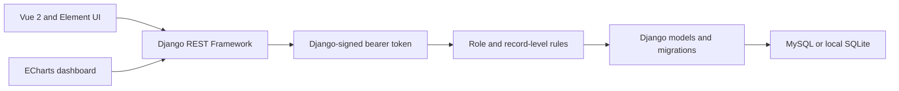

# Django + Vue HR Management

An HR dashboard that brings employee records, approval workflows and workforce statistics into a single interface. The application models departments and positions separately from employee profiles, then uses those relationships in HR workflows and reports.

## Architecture



- **Vue 2, Element UI and ECharts** render management screens and workforce dashboards.
- **Django REST Framework** provides request handling, serialization, viewsets and custom actions.
- **Django signing** creates and verifies the bearer token consumed by `SignedTokenAuthentication`. The legacy module name is `jwt.py`.
- Role and record checks govern employee and manager actions. The business modules cover attendance, leave, overtime, payroll, performance, recruitment and operation logs.
- The import code uses pandas and openpyxl to read Excel data. Use synthetic workbooks for demos. On rows with a blank password, an existing account keeps its password and a newly imported account cannot sign in until an administrator sets a password.

## Repository layout

`src/` contains the Vue application. `MyWeb/Model/` contains models, serializers, permissions helpers, views, tests and migrations. `MyWeb/MyWeb/` holds backend settings and URL configuration.

## Local setup

Use an isolated Python environment. Copy the example and populate a random `DJANGO_SECRET_KEY`. SQLite is the example's local option. For MySQL, set `HR_DATABASE=mysql` and fill the `DB_*` variables for an empty database.

```powershell
cd MyWeb
python -m pip install -r requirements.txt
Copy-Item .env.example .env
# Edit .env before running Django.
python manage.py migrate
python manage.py createsuperuser
python manage.py runserver 127.0.0.1:8001
```

In another terminal, run `npm ci` and `npm run serve` from the repository root. Open port 8080. For a demo, use newly created accounts and synthetic employee records.

The migration archive omitted the Django settings module. The portfolio copy defines it using environment variables. The archived dependency versions are appropriate for reproducing the original coursework behavior in a local environment. Review dependency upgrades before any shared deployment.


## Verification

The Vue production build passed. Django's system check passed, and all 9 tests passed with an isolated SQLite test database (7 RBAC cases and 2 Excel import password cases). The tests sign in through the application's login endpoint and verify administrator access, employee data filtering and forbidden actions. To rerun, configure the local environment as above and run `python manage.py test Model.tests_rbac Model.test_excel_import_password` from `MyWeb/`. MySQL integration has not been exercised here.
